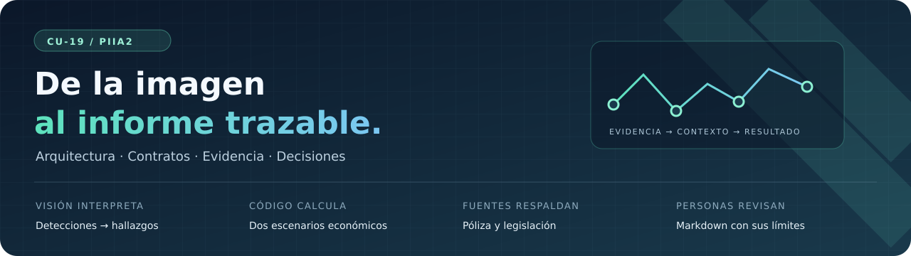
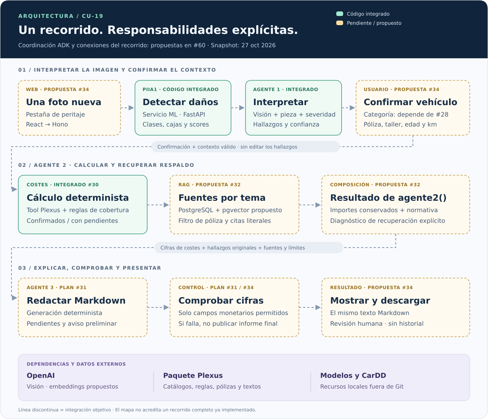
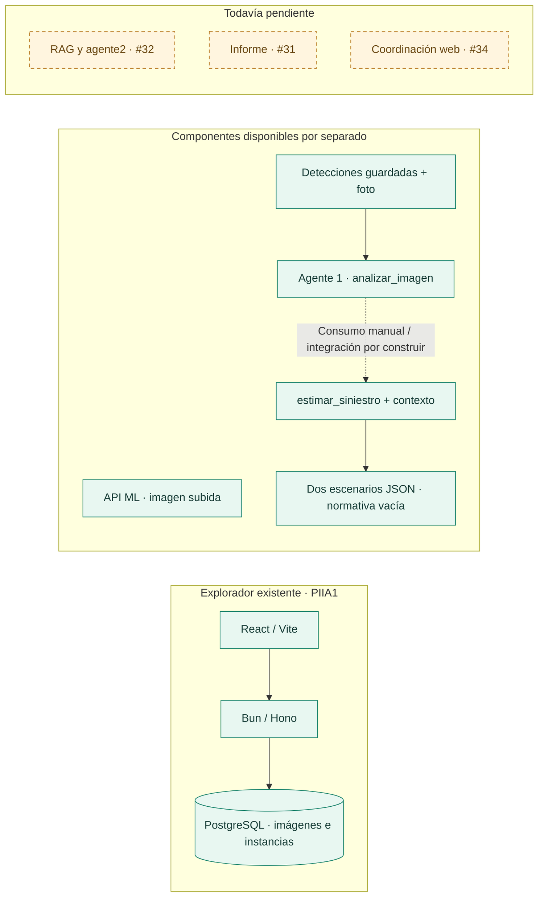
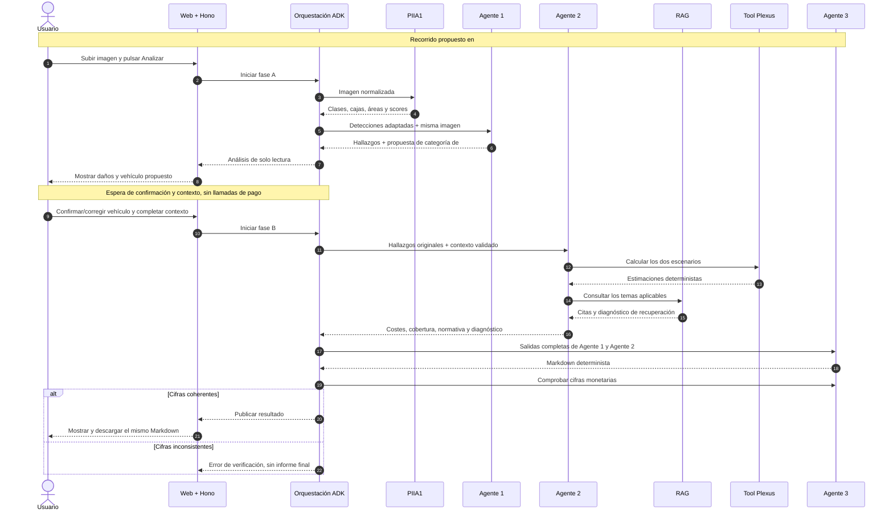
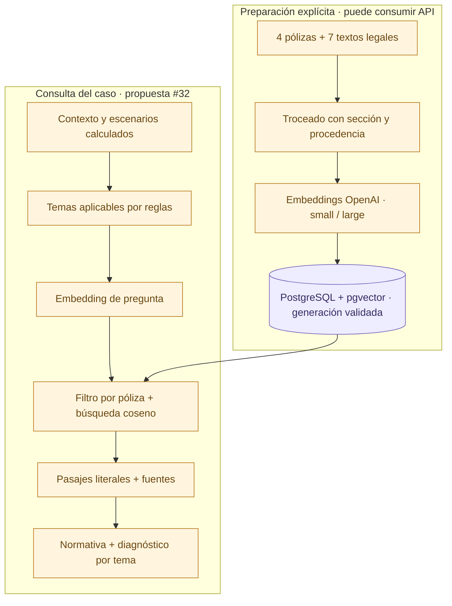
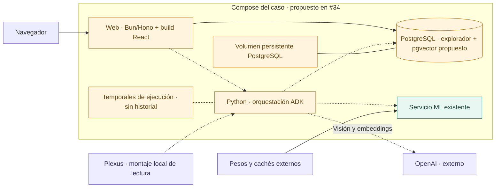
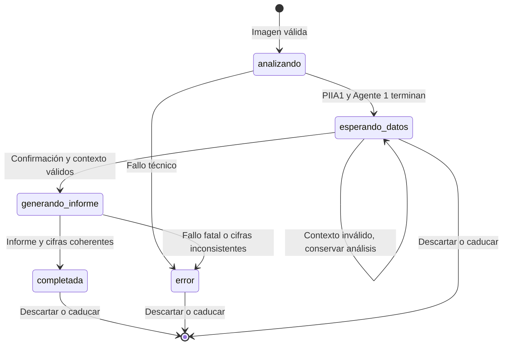

<p align="center">
  
</p>

# Arquitectura · Interpretación de daños en vehículos

**Una fotografía se convierte en hallazgos; los hallazgos, en dos estimaciones; las estimaciones y sus fuentes, en un informe para revisión humana.**

| Caso de uso | Base documentada | Lectura del estado |
|---|---|---|
| CU-19 · PIIA2 · Plexus | [`main` · `d5dd44d`](https://github.com/lvckss/piia2-26/tree/d5dd44d4ff89d64fecb7eeff83ef7a55b5b560af) · 27 de octubre de 2026 | Componentes existentes y evolución propuesta, identificados por separado. |

> [!IMPORTANT]
> Este documento describe un **snapshot**, no acredita que el flujo completo esté implementado. Agente 1 y costes tienen código integrado. El informe tiene su plan integrado; RAG y orquestación web siguen en las propuestas [#56][pr56] y [#60][pr60]. Documentarlas aquí no acepta sus ADRs ni habilita su implementación.

<p align="center">
  <a href="#01--el-sistema-en-un-vistazo">Mapa del sistema</a> ·
  <a href="#02--qué-existe-hoy">Estado real</a> ·
  <a href="#03--de-la-foto-al-informe">Recorrido</a> ·
  <a href="#04--contratos-y-datos">Contratos</a> ·
  <a href="#07--ejecución-y-despliegue">Despliegue</a> ·
  <a href="#11--decisiones-y-trazabilidad">Decisiones</a>
</p>

## 01 · El sistema en un vistazo

El usuario es un perito o tramitador que necesita interpretar daños visibles,
obtener una estimación orientativa y entender qué la respalda. El sistema asiste
esa revisión: conserva incertidumbre, separa escenarios y muestra procedencia.

| VISIÓN | CÁLCULO | FUENTES | INFORME |
|---|---|---|---|
| PIIA1 propone detecciones; Agente 1 contrasta la imagen. | La herramienta de Plexus y el código de cobertura calculan los importes. | El RAG recuperará pasajes de póliza y legislación con su referencia. | Agente 3 generará Markdown; la orquestación verificará sus importes antes de publicarlo. |



**Cómo leer el mapa.** Verde indica código integrado; ámbar, una pieza planificada
pendiente de implementación o aceptación; violeta identifica datos o servicios
externos. Las conexiones discontinuas muestran la integración objetivo. Tener
dos componentes implementados no implica que estén conectados automáticamente.
El SVG es vectorial y se puede abrir para ampliarlo.

**Descripción textual del mapa.** La web propuesta envía una foto al servicio
de orquestación, que coordina PIIA1 y Agente 1. Tras la confirmación del vehículo
y la introducción del contexto, Agente 2 combinará costes con recuperación
documental. Agente 3 consumirá los hallazgos y el resultado económico completo.
La comprobación monetaria precederá a la presentación y descarga. OpenAI
interviene en visión y embeddings; Plexus aporta catálogos, reglas y documentos.
La PostgreSQL actual del explorador no tiene todavía el índice vectorial propuesto.

### Cinco reglas que atraviesan la arquitectura

1. **Las cifras proceden del código.** El modelo visual interpreta daños;
   no fija precios, franquicias ni indemnizaciones.
2. **La duda viaja con el hallazgo.** `confirmed` y `needs_review` se conservan
   hasta el informe; un rechazo visual también queda explicado.
3. **La procedencia acompaña a la fuente.** Un extracto recuperado mantiene
   documento y sección. Recuperarlo no equivale a verificar una conclusión jurídica.
4. **El contexto económico lo aporta el usuario.** Vehículo, taller, póliza,
   antigüedad y kilómetros determinan el cálculo. La propuesta de categoría
   requiere confirmación; no identifica por sí sola marca y modelo exactos.
5. **La revisión humana sigue siendo necesaria.** Los precios, pólizas y reglas
   de evaluación económica son sintéticos; la legislación es un snapshot real.
   El prototipo no produce una tasación vinculante.

## 02 · Qué existe hoy

El código y los contratos de este apartado se contrastaron con el commit base.
Las referencias a propuestas abiertas fijan sus versiones para que el documento
no cambie de significado cuando se actualice una rama.

| Pieza | Estado en el snapshot | Evidencia y límite |
|---|---|---|
| Detección PIIA1 | **Código integrado** | [`StrategyPipeline/`](app/ml/StrategyPipeline/) y [`ml/api/`](app/ml/api/). La API admite una imagen; los agentes se han desarrollado con detecciones guardadas. |
| Explorador web | **Código integrado, heredado de PIIA1** | [`routes/explorer.tsx`](app/frontend/src/routes/explorer.tsx), Hono y schema SQL. Todavía no hay pestaña de peritaje. |
| Agente 1 | **Código integrado** | [`analizar_imagen`](app/agentes/agente_multimodal/agente1.py): detecciones + foto → hallazgos enriquecidos con visión. |
| Categoría de vehículo | **Propuesta por adaptar** | [#28][i28] / [#29][pr29], aparcada en el plan anterior; [#60][pr60] propone retomarla con confirmación. No está en el Agente 1 integrado. |
| Costes y cobertura | **Código integrado por [#59][pr59]** | [`estimar_siniestro`](app/agentes/agente_recuperacion/costes_y_cobertura.py) produce ambos escenarios. Devuelve `normativa: []`. |
| RAG + `agente2()` | **Borrador abierto [#56][pr56]** | [Spec v1.2][rag-spec] y [ADR 0006 Propuesto][adr6]. No hay implementación productiva de recuperación. |
| Agente 3 | **Plan v2 integrado por [#58][pr58]; implementación pendiente** | [Spec #31](specs/31-informe-peritaje.md); [`agente_redactor/`](app/agentes/agente_redactor/) solo contiene README. El diagnóstico RAG depende del contrato de #56. |
| ADK + OpenAI | **Experimento integrado por [#52][pr52]** | [`orquestador/README.md`](app/agentes/orquestador/README.md). Acredita una tool y su cifra, no la coordinación del producto. |
| Orquestación y web de peritaje | **Borrador abierto [#60][pr60]** | [Spec v1][orq-spec] y [ADR 0007 Propuesto][adr7]. Las rutas, estados y servicios nuevos no existen todavía. |
| Docker Compose | **Integrado para ML** | [`docker-compose.yml`](app/docker/ml-api/docker-compose.yml) levanta el servicio ML. El Compose del conjunto es parte de #34. |

### Conexiones disponibles y conexiones pendientes



La API ML y el JSON que recibe Agente 1 tienen formas distintas. La adaptación
entre ambas es trabajo previsto de #34, no una conexión ya disponible. El
archivo `server/routes/sam3Route.ts` existe, pero **no está montado** en
[`server/app.ts`](app/server/app.ts): su presencia no acredita integración web.

## 03 · De la foto al informe

### Recorrido actual de desarrollo

Los ejemplos permiten trabajar por componentes sin esperar al recorrido web:

1. Una exportación de PIIA1 conserva detecciones y la referencia de la foto.
2. Agente 1 filtra candidatas, crea recortes, consulta visión y produce JSON.
3. Un consumidor combina esa salida con el contexto del siniestro y llama
   a `estimar_siniestro`.
4. La salida contiene dos escenarios y una lista `normativa` vacía. El informe
   aún se describe mediante su plan y ejemplos de referencia.

Los [`ejemplos_contrato/`](app/agentes/ejemplos_contrato/README.md) fijan la
frontera común. El ejemplo de Agente 1 está escrito a mano; sus cifras de
Agente 2 se calcularon con la herramienta real; los extractos de `normativa`
son ilustrativos. Hay además [30 salidas reales de Agente 1](app/agentes/ejemplos_contrato/agente1_real/README.md),
sin contexto, fotos ni recortes versionados.

### Recorrido objetivo desde la web · propuesta #60

El usuario subirá **una imagen nueva en una pestaña separada**. El recorrido
tendrá dos fases: analizar la imagen y, después de completar los datos,
generar el informe. No se editarán manualmente los hallazgos.



La secuencia resume las dependencias lógicas; no prescribe paralelismo, número
de consultas ni detalles internos de las funciones. Agente 2 ejecutará costes
una vez como operación compuesta, que internamente calcula ambos escenarios.

### Vehículo y contexto: lo que la foto no puede resolver

La propuesta de categoría distingue ocho grupos: `A`, `B`, `C`, `SUV-B`,
`SUV-C`, `FURG`, `C-PREMIUM` y `D-PREMIUM`. Un vehículo representante del catálogo
sirve para estimar; no demuestra que sea el modelo fotografiado.

La propuesta #60 pide confirmación o selección explícita. Con categoría
`desconocido`, el usuario seleccionará un vehículo; no se asumirá uno por defecto.
Este comportamiento necesita adaptar la propuesta anterior de #29 y acordar
con #31 cómo mostrar la procedencia. El contrato definitivo sigue pendiente.

La póliza, rol, taller, región, acabado, tipo de pieza, antigüedad y kilómetros
se recogen del contexto. Una imagen de un golpe no permite deducir esas condiciones.
En el código actual `vehiculo_id` es siempre obligatorio.

## 04 · Contratos y datos

La frontera estable entre agentes son **diccionarios JSON serializables por
imagen**, según [ADR 0002](../../docs/adr/0002-contrato-json-entre-agentes.md).
Los ejemplos son la referencia común; el documento no añade campos al contrato.

| Frontera | Entrada → salida | Estado |
|---|---|---|
| HTTP de PIIA1 | Archivo → `vehicle_damage_assessment[]` con clase, bbox, área y score; visualización opcional | Implementada |
| Adaptación ML → Agente 1 | Respuesta HTTP → `image_id`, `image_path`, `predictions[]` con índice, clase, bbox xywh y score | Propuesta #34 |
| Agente 1 → consumidores | `image_id`, `resumen_filtro_previo`, `findings[]` | Implementada; ADR 0002 |
| Contexto → costes | Catálogos, condiciones y rol del siniestro | Implementada |
| Costes → consumidor | Contexto, valor venal, umbral, dos escenarios, motivos y `normativa` | Implementada; normativa vacía |
| RAG → consumidor | Lista de `{tema, extracto, fuente}` | Propuesta #32 |
| `agente2()` → informe/orquestación | Resultado económico conservado + citas + `diagnostico_rag` | Propuesta #32; ADR 0006 |
| Agente 3 → orquestación | Markdown; comprobación devuelve importes no permitidos | Plan #31; implementación pendiente |
| Web → orquestación | Imagen, ejecución, contexto y confirmación; estado y Markdown de respuesta | Propuesta #34; ADR 0007 |

### 4.1 · Dos formatos de detecciones

La [respuesta HTTP de ML](app/ml/api/schemas/response.py) publica:

```text
vehicle_damage_assessment[]
  damage_class
  bbox { x, y, width, height }
  area
  score
visualization? { mime_type, image_base64 }
```

[`hallazgos.py`](app/agentes/agente_multimodal/hallazgos.py) consume:

```text
image_id
image_path                 # utilizado después para recortar y consultar visión
predictions[]
  instance_index
  damage_class
  bbox_xywh
  score
```

La adaptación propuesta conservará coordenadas y scores sobre la misma imagen
normalizada. Asignará identificadores e índices estables, sin inventar detecciones.
El filtro seguirá siendo responsabilidad de Agente 1.

### 4.2 · Hallazgo interpretado

Cada candidata produce un `finding_id` del tipo `160-1`. El contrato contiene
exactamente estos trece campos por hallazgo:

| Grupo | Campos | Qué permiten seguir |
|---|---|---|
| Identidad y geometría | `finding_id`, `category`, `clase_tool`, `bbox_xywh` | Relación con la detección y traducción al vocabulario de la tool. |
| Confianza | `score`, `score_tier`, `confidence_tier` | Diferencia entre el score original y la decisión final. |
| Segunda opinión visual | `vision_verdict`, `vision_description`, `crop_image_path` | Confirmación, rechazo o incertidumbre, descripción y recorte asociado. |
| Presupuesto | `pieza_id`, `severidad`, `regla_coste_aplicable` | Si existe una combinación utilizable por la herramienta de costes. |

`resumen_filtro_previo` conserva `detecciones_totales`, `candidatas` y
`descartadas_por_clase`. Las detecciones excluidas antes de visión quedan contadas;
las candidatas que visión rechaza permanecen como hallazgos pendientes con su motivo.
Las rutas de recortes son referencias internas, no archivos garantizados en Git
ni rutas que deba aceptar un navegador.

**`confirmed` exige la combinación** del umbral de score de la clase,
`vision_verdict = "confirmado"`, una pieza y una regla de coste aplicable.
El resto es `needs_review`. Los umbrales de confianza de
[`confianza.py`](app/agentes/agente_multimodal/confianza.py) están señalados en
el código como punto de partida pendiente de calibración; no son porcentajes
de probabilidad de que el diagnóstico sea correcto.

### 4.3 · Contexto del siniestro

El [JSON de contexto](app/agentes/ejemplos_contrato/contexto_siniestro.json)
del ejemplo identifica un Volkswagen Golf de catálogo (`V05`), con póliza
`P-TR-FR300`, tres años y 42.000 km.

| Campos | Papel en el cálculo |
|---|---|
| `vehiculo_id` | Referencia válida del catálogo: piezas, precios y valor venal. |
| `region`, `tipo_taller` | Condiciones de tarifas de reparación. |
| `acabado`, `tipo_pieza` | Pintura y tipo de recambio. |
| `edad_anios`, `km` | Valor venal; números finitos, no negativos y no booleanos. |
| `rol` | `propio` o `tercero_perjudicado`; selecciona la lógica de cobertura. |
| `poliza_id` | Obligatorio y reconocido con rol propio; no condiciona la rama de tercero. |

La validación actual comprueba campos obligatorios, rol, vehículo, antigüedad,
kilómetros y póliza cuando corresponde. No se atribuye a `validar_contexto`
una validación exhaustiva de todos los catálogos de taller/acabado/región:
el formulario y sus validaciones son parte de la integración propuesta.

### 4.4 · Dos escenarios económicos, una misma entrada

[`estimar_siniestro`](app/agentes/agente_recuperacion/costes_y_cobertura.py)
separa los hallazgos en tres grupos:

| Grupo | Condición | Efecto |
|---|---|---|
| Confirmados | `confidence_tier = confirmed` | Entran en ambos escenarios. |
| Pendientes presupuestables | No rechazados, con pieza, severidad y regla | Solo se añaden a `con_pendientes`. |
| Fuera del coste | Rechazo visual, pieza/severidad ausente o sin regla | Se conserva `finding_id` y motivo; no se presupuesta. |

La salida común tiene esta forma; cada escenario conserva la estimación de
la herramienta y su cobertura calculada:

```text
image_id, contexto, valor_venal_eur, umbral_perdida_total
escenarios
  confirmados
    hallazgos_incluidos[]
    estimacion { lineas, desglose, subtotal_sin_iva_eur, iva_eur,
                 total_con_iva_eur, arrastres_posibles, ... }
    cobertura { cubierto, motivo, franquicia_eur, perdida_total,
                indemnizacion_estimada_eur }
  con_pendientes
    [las mismas claves]
hallazgos_fuera_del_coste[] { finding_id, motivo }
normativa[] { tema, extracto, fuente }
```

Los puntos suspensivos de este esquema son una abreviación del documento;
la forma completa está en el [JSON de Agente 2](app/agentes/ejemplos_contrato/agente2_salida.json).
Con cero daños se mantienen las claves, importes cero y listas vacías.

### 4.5 · Un caso completo con cifras del contrato

El ejemplo de imagen **160** contiene cinco hallazgos: dos confirmados, dos
pendientes presupuestables y uno rechazado por visión. Su valor venal es
**17.491,54 €**, con umbral de pérdida total **0,75**.

| Concepto | Solo confirmados | Con pendientes |
|---|---:|---:|
| Hallazgos incluidos | `160-1`, `160-4` | `160-1`, `160-4`, `160-3`, `160-5` |
| Subtotal sin IVA | 1.019,46 € | 1.488,23 € |
| IVA | 214,09 € | 312,53 € |
| **Total con IVA** | **1.233,55 €** | **1.800,76 €** |
| Franquicia | 300,00 € | 300,00 € |
| **Indemnización estimada** | **933,55 €** | **1.500,76 €** |
| Pérdida total | No | No |

`160-2` queda fuera por `rechazado_por_vision`. La diferencia entre columnas
representa la incorporación de hallazgos pendientes; no es un intervalo
estadístico de confianza. Los posibles daños asociados (`arrastres_posibles`)
son advertencias y no se añaden automáticamente a los importes.

Estas cifras son las del archivo versionado, no el resultado de una ejecución
nueva realizada para este documento.

## 05 · Responsabilidad de cada componente

### PIIA1 · Detectar y segmentar

El pipeline heredado tiene la frontera `ImageSample → StrategyResult`.
Existen estrategias `baseline`, `sahi` y `geometric_ensemble`; la configuración
de la API selecciona una y carga el predictor al arrancar. El evaluador permite
comparar detecciones con las anotaciones de CarDD.

La API [`POST /v1/damage-assessment`](app/ml/api/routes/damage_assessment.py)
acepta un archivo y devuelve la vista de detecciones. Puede incluir una imagen
anotada en base64. La respuesta pública no transporta todo el objeto interno
de segmentación ni ofrece por sí sola un diagnóstico pericial.

La API valida tipo de contenido, archivo vacío y decodificación. No se afirma
que ya aplique los límites de tamaño/píxeles y la normalización de orientación
que propone #34 para el flujo web.

### Agente 1 · Interpretar la evidencia visual

[`analizar_imagen`](app/agentes/agente_multimodal/agente1.py) coordina:
carga de detecciones → selección → recortes → visión → JSON del contrato.
El cliente OpenAI y el modelo se configuran explícitamente; el catálogo de
Plexus restringe piezas y reglas válidas.

El [filtro previo](app/agentes/agente_multimodal/seleccion.py) aplica
`score_min = 0.5` a `glass shatter` y `top_k = 2` por imagen/clase a
`lamp broken`, `tire flat`, `dent`, `scratch` y `crack`. La clase desconocida
usa el filtro por defecto. Este filtro reduce candidatas enviadas a visión;
no debe confundirse con los umbrales del tier final.

La segunda opinión del modelo puede confirmar, rechazar o quedar incierta.
Los consumidores posteriores respetan esa salida y no promocionan por su
cuenta un hallazgo para aumentar el presupuesto.

### Agente 2 · Calcular y aportar respaldo documental

Tiene dos responsabilidades con estados de implementación distintos:

- **Costes y cobertura, implementados:** `estimar_siniestro` valida contexto,
  clasifica hallazgos, llama a `estimar_coste` para los escenarios y calcula
  cobertura, franquicia, pérdida total e indemnización con reglas de código.
- **Composición RAG, propuesta:** `agente2()` de #32 conservará todos esos
  resultados, rellenará `normativa` y añadirá el diagnóstico de recuperación.

La herramienta externa `estimar_coste` aporta procedimientos, piezas, mano de
obra y totales. La lógica de cobertura reproduce el generador sintético de
siniestros de Plexus. No consulta a un LLM para decidir cuánto pagar.

La pérdida total se compara con el **subtotal sin IVA** y el valor venal.
Las reglas diferencian daños propios, cristal y tercero perjudicado; su detalle
pertenece a [#30](specs/30-costes-cobertura.md) y al código, que son la referencia
para los cálculos. La recuperación documental no sustituirá esas reglas.

### Agente 3 · Explicar el resultado sin inventar importes

El [plan de #31](specs/31-informe-peritaje.md) define:

```text
generar_informe(agente1, agente2, hoy=None) -> str
comprobar_cifras(informe, agente2) -> list[float]
```

El generador será determinista: cabecera y aviso, resumen, confirmados,
pendientes, detecciones fuera del coste, desglose, daños asociados, cobertura
y fuentes. No necesita una llamada de red para redactar las cifras.

El comprobador devuelve los importes en euros que no pertenecen a los campos
monetarios permitidos: claves `_eur`, importes de líneas y valores de `desglose`.
No debe aceptar `image_id`, kilómetros, años o probabilidades como dinero.
Una lista vacía significa que no encontró importes ajenos según ese control;
**no demuestra corrección jurídica, exhaustividad ni calidad de la percepción**.

La propuesta #34 convierte ese control en condición de publicación. El mismo
texto Markdown se mostrará y descargará; PDF e historial quedan fuera.

### Orquestación · Coordinar fases y preservar contratos

El experimento de #33 prueba ADK con OpenAI a través del conector LiteLLM.
La propuesta de #34 adopta workflows nativos de orden fijo, con adaptadores
para las funciones existentes y estado aislado por ejecución. No añade un
modelo coordinador que pueda reescribir cifras o saltarse la verificación.

La fase A termina esperando al usuario. La fase B consume la salida original
de Agente 1 y el contexto validado, llama a `agente2()`, genera Markdown y lo
comprueba. La versión y compatibilidad del entorno de producto se verificarán
al implementarlo; el entorno del experimento no acredita ya esa integración.

## 06 · RAG: recuperación con fuentes

> [!NOTE]
> Todo este apartado resume la [propuesta versionada de #32][rag-spec]. PostgreSQL
> con pgvector, el esquema documental y `diagnostico_rag` siguen sujetos a la
> aceptación de [ADR 0006][adr6].

### Por qué conviven datos estructurados y documentos

Los CSV permiten calcular cobertura y costes del prototipo. Las pólizas completas
y los textos legales permiten mostrar al lector **qué pasaje respalda el tema
consultado**. Esa función documental es distinta de volver a calcular el importe.

La primera entrega de RAG seguirá la opción A: recuperación de respaldo para
las conclusiones calculadas. La opción B —usar el contenido para advertencias
adicionales de exclusiones o plazos— es una evolución requerida posterior, con
plan propio; no se presenta como capacidad actual.

### Dos recorridos: preparar el corpus y consultar un caso



Se propone trocear pólizas por sección y legislación por artículo; los bloques
largos se dividen en ventanas. Cada generación identifica corpus, troceado,
modelo y dimensiones. Una generación incompleta no sustituye la activa.

La frontera prevista es
`buscar_normativa(pregunta, k=4, poliza_id="") -> list[dict]`, con tres campos
no vacíos por resultado: `tema`, `extracto`, `fuente`.

| Contexto | Corpus elegible |
|---|---|
| Póliza reconocida | Esa póliza y legislación; nunca otras pólizas por similitud. |
| `poliza_id=""` | Solo legislación. Se usa en tercero perjudicado. |
| Póliza desconocida | Error de entrada explícito. |

El top-k devuelve candidatos ordenados; no garantiza pertinencia. El plan no
fija un umbral de relevancia sin calibración ni inicia indexado al consultar.
El arranque tampoco debe generar embeddings ni lanzar evaluaciones de pago.

### Qué significa que falten fuentes

`diagnostico_rag` es una ampliación propuesta del JSON de Agente 2. Conserva
el estado global y una lista de consultas con `tema`, estado, fuentes e incidencias.
Cada incidencia tiene `codigo`, `etapa`, `mensaje` y `reintentable`.

| Estado global | Condición | Tratamiento previsto en el informe |
|---|---|---|
| `recuperadas` | Todas las consultas aplicables recuperaron fragmentos. | Citas presentes; sin aviso preliminar por ausencia de fuentes. No se etiqueta como «verificado». |
| `parcial` | Algunas tienen fuentes y otras no o fallan. | Conservar citas válidas, mostrar aviso preliminar y motivos de los temas sin fuentes. |
| `sin_resultados` | Consultas ejecutadas correctamente, todas sin fragmentos. | Aviso preliminar y ausencia de fuentes explicada. |
| `error` | Ninguna tiene fuentes y al menos una consulta falla. | Aviso preliminar con causas; no ocultar el fallo como resultado vacío válido. |
| `no_aplica` | No hay temas que consultar. | Sin aviso de fallo; una lista vacía aquí es válida. |

Texto de referencia acordado entre los planes #32 y #31:

> Informe preliminar: no se han recuperado fuentes suficientes para respaldar
> las conclusiones indicadas sobre cobertura e indemnización. Estas conclusiones
> requieren revisión.

La [v2 de #31](specs/31-informe-peritaje.md) incorpora AC-014 y AC-015 para
consumir ese contrato, condicionados a su aceptación. El lector verá tema y
mensaje, no códigos internos de infraestructura. Los errores de costes, contratos
o programación inesperados no se convertirán en un informe preliminar válido.

## 07 · Ejecución y despliegue

### Lo disponible

La aplicación heredada combina React/Vite, Bun/Hono, PostgreSQL y un servicio
ML Python/FastAPI. El [Compose existente](app/docker/ml-api/docker-compose.yml)
solo cubre ML, con modelo montado en lectura y caché de Hugging Face. Tiene
una [extensión GPU](app/docker/ml-api/docker-compose.gpu.yml).

Hono monta `/api/images` y `/api/instances`, sirve archivos del dataset y el
frontend compilado. Su cliente PostgreSQL exige `DATABASE_URL` al arrancar.
El [`schema.sql`](app/bd/schema.sql) contiene `etiquetas`, `imagenes` e
`instancias`; los campos JSONB de segmentación **no constituyen un índice vectorial**.

Los agentes y sus scripts se ejecutan por separado. El código de costes busca
la raíz `.git` y el paquete `piia2_paquete_datos/`; el empaquetado del producto
debe resolver esa dependencia de rutas. No se propone montar el historial Git
en un contenedor para que encuentre los CSV.

### Topología objetivo · propuesta #60



La PostgreSQL relacional ya existe como dependencia; **su integración en este
Compose y la extensión vectorial** son parte de la propuesta, como muestra el
color de su nodo. El objetivo es una sola instancia con datos del explorador
y almacenamiento RAG separados, no dos despliegues independientes.

La ubicación propuesta es `compose.yaml` en la raíz de la carpeta del caso,
para que pueda viajar en la entrega. Todavía no existe ese archivo. El comando
de arranque se documentará y verificará al implementar #34; este documento
no lo presenta como una instrucción ejecutable actual.

| Recurso | Persistencia actual / propuesta |
|---|---|
| Dataset del explorador | Datos externos y schema relacional existente; carga explícita. |
| Fragmentos y vectores RAG | Persistentes en volumen PostgreSQL, propuesto en #32. |
| Fotos subidas, recortes, estado y Markdown | Temporales por ejecución, propuesto en #34. Sin historial de casos. |
| Catálogos, reglas y documentos Plexus | Paquete local externo; montaje de lectura propuesto. |
| Pesos y cachés ML | Externos; modelo de lectura y caché según configuración del servicio. |
| Claves de proveedor | Entorno local del servicio; nunca en Git ni en el navegador. |

La carga de CarDD y el indexado del corpus serán preparaciones explícitas.
La propuesta permite procesar una foto subida sin poblar el explorador con CarDD.
Se deben documentar y probar versiones, límites y disponibilidad de modelos;
no se promete una latencia ni una capacidad de GPU sin medición.

## 08 · Estados, errores y degradación

### Ciclo de vida propuesto para un caso



Los nombres son los de [#60][orq-spec]. La falta de fuentes del RAG no exige
por sí sola `estado=error`: puede producir un informe completado con aviso
preliminar. Un error monetario impide publicar el informe.

| Condición | Situación actual o comportamiento propuesto | Frontera responsable |
|---|---|---|
| Archivo vacío/no imagen/indecodificable | ML ya rechaza entradas; #34 ampliará validación antes de llamar al proveedor. | Entrada web y API ML |
| Predictor no disponible o inferencia fallida | API ML responde con error; el caso deberá detenerse señalando etapa. | ML → orquestación |
| Hallazgo dudoso, rechazado o sin regla | Se conserva como pendiente o fuera del coste; no equivale a caída del servicio. | Agente 1 y costes |
| Contexto inválido | Costes lanza `ValueError`; la web propuesta informará campos y conservará fase A. | Contexto → costes |
| Consulta correcta sin fuentes | `sin_resultados`, diferente de caída de DB/proveedor. | RAG propuesto |
| Parte de consultas falla | Conservar las fuentes válidas y explicar incidencias. | RAG → informe |
| Importes ajenos al resultado económico | #31 los detectará; #34 bloqueará publicación. | Verificación final |
| Dos clics o reenvío de petición | Idempotencia y transición atómica propuestas; no repetir llamadas de pago. | Web → orquestación |
| Reinicio o ejecución caducada | Caso no disponible; no prometer restauración ni repetir el recorrido en silencio. | Estado temporal propuesto |

La API pública propuesta se agrupa bajo `/api/peritajes`: catálogo, inicio,
consulta de estado, generación, descarga y descarte. Son **rutas nuevas de #60**,
no endpoints del backend actual. Los errores llevan código, etapa, mensaje y
si son reintentables. Una operación aceptada con `202` puede fallar después:
la consulta de su estado reflejará el fallo del caso sin confundirlo con un
error de transporte del polling. El contrato HTTP completo permanece en la spec.

## 09 · Datos, privacidad y límites de confianza

| Activo | Procedencia | Qué se puede afirmar |
|---|---|---|
| Imágenes y anotaciones | CarDD, usado en PIIA1 y pruebas de Agente 1 | Son datos de evaluación, no un historial real de una aseguradora. |
| Vehículos, piezas, tarifas, reglas y pólizas | Paquete sintético de Plexus | Permiten cálculo reproducible del prototipo; no acreditan precios comerciales. |
| Legislación | Textos reales incluidos en el paquete | Se usa el snapshot recibido, sin verificar vigencia jurídica en cada ejecución. |
| Respuesta de visión | Modelo OpenAI sobre la imagen | Puede equivocarse; tier, rechazo e incertidumbre deben conservarse. |
| Pasajes recuperados | Corpus indexado propuesto | Acreditan procedencia y recuperación, no interpretación jurídica automática. |

La fotografía y sus recortes se envían a OpenAI al usar visión. La propuesta
de embeddings implica enviar fragmentos del corpus y preguntas al proveedor.
Los CSV de costes se procesan localmente. Esto describe fronteras de datos;
no atribuye al prototipo una auditoría de privacidad ni una garantía de producción.

Las fotos, pesos, dumps de bases de datos, claves y paquete privado permanecen
fuera del repositorio. Los ejemplos JSON versionados no incluyen las fotos.
La futura vista web omitirá rutas internas; el servidor asignará identificadores
y nombres de archivos. El Markdown se renderizará con HTML crudo deshabilitado
o saneado, según #34. Estas protecciones de la nueva pestaña son requisitos
pendientes de implementación y verificación.

## 10 · Evidencia, evaluación y reproducibilidad

No hay una única cifra que demuestre la calidad del sistema completo. Cada
frontera necesita su verificación, y la integración aún tiene trabajo pendiente.

| Nivel | Evidencia disponible o prevista | Límite de la afirmación |
|---|---|---|
| Contratos | Ejemplos JSON y pruebas por componente; [ADR 0002](../../docs/adr/0002-contrato-json-entre-agentes.md). | Coincidir en claves no demuestra calidad visual ni pericial. |
| Visión | [Lote real](app/agentes/ejemplos_contrato/agente1_real/README.md): 30 imágenes, 234 hallazgos, 48 `confirmed` y 186 `needs_review`. | Selección orientada a cubrir clases; no es una muestra representativa ni una evaluación global. |
| Costes | [#59][pr59] documenta tests y evaluación frente a siniestros sintéticos. | Reproduce el entorno sintético, no una tasación real. |
| ADK | [Prueba #33](app/agentes/orquestador/README.md): una tool real invocada una vez y `1233.55` conservado. | No prueba los tres agentes, RAG, web ni el flujo completo. |
| Recuperación | [#32][rag-spec] prevé 25 preguntas: 16 de póliza y 9 legales; comparación small/large y baseline directo de pólizas. | Objetivo del modelo elegido: ≥24/25; **pendiente de medir**, benchmark conocido, sin garantía de generalización. |
| Informe | [#31](specs/31-informe-peritaje.md) prevé ejemplos, bordes y comprobación monetaria restringida. | Funciones productivas pendientes en el snapshot. |
| Integración | [#34][orq-spec] prevé 3–5 casos reales del recorrido web; [#46][i46] la evaluación global. | No se han ejecutado como parte de esta documentación. |

### Qué acreditó exactamente ADK

La segunda tentativa real utilizó ADK 2.12.0 y LiteLLM 1.106.0, con
`gpt-6.1-sol`, effort `high`, mediante el bridge Responses. La tool se ejecutó
una vez y devolvió el importe intacto. El proceso original terminó con código
1 porque el comparador no admitía el envoltorio `{"result": "...JSON..."}`.

Se conservó esa captura y se corrigió el comparador; su revalidación local
pasó junto a 17 pruebas deterministas. **No hubo una tercera ejecución real
del CLI corregido.** La evidencia y los límites están en
[`evidencia-33-intento-2.json`](app/agentes/orquestador/evidencia-33-intento-2.json).
Este resultado habilita estudiar la integración; no acepta por sí solo ADR 0007.

### Qué medirá el RAG propuesto

Se compararán `text-embedding-3-small` y `text-embedding-3-large`, inicialmente
con 1.536 y 3.072 dimensiones según el plan, sin mezclar sus vectores. Se
mantendrán corpus, troceado, filtro y `k=4`, registrando fuentes recuperadas,
hit@4, suficiencia juzgada por una persona, tiempos, tokens y costes disponibles.
La búsqueda inicial será exacta por coseno.

Las dieciséis preguntas de póliza se compararán también con recuperación
directa por póliza/sección, para saber qué aporta la búsqueda vectorial.
Las respuestas esperadas solo se usarán al puntuar. Cambios de protocolo se
versionarán; no se presentará el objetivo de calidad como resultado conseguido.

Para reproducir un resultado harán falta versión del código, datos y hashes,
modelo/configuración, partición y selección de casos, parámetros, tiempos y
evidencia original. Los comandos específicos viven en los README y planes
de cada componente; aquí no se lanza ninguna ejecución de pago.

## 11 · Decisiones y trazabilidad

### Decisiones aceptadas e integradas

| ADR | Decisión que documenta | Consecuencia en esta arquitectura |
|---|---|---|
| [0002 · Contrato JSON](../../docs/adr/0002-contrato-json-entre-agentes.md) · **Aceptado** | Hallazgos completos, confianza y dos escenarios. | Los agentes conservan el contrato; no desaparecen dudas ni se recalculan tiers. |
| [0003 · OpenAI](../../docs/adr/0003-proveedor-openai-clave-empresa.md) · **Aceptado** | Proveedor y clave de la empresa. | Visión usa ese proveedor; configuración y secretos quedan fuera de Git. |
| [0004 · Herramienta de costes](../../docs/adr/0004-herramienta-costes-datos-empresa.md) · **Aceptado** | Tool y datos recibidos de Plexus. | Cálculo determinista y datos sintéticos; el RAG no inventa procedimientos ni precios. |
| [0005 · Filtro previo](../../docs/adr/0005-filtro-previo-detecciones-por-clase.md) · **Aceptado** | Selección de candidatas antes de visión. | La orquestación entrega las detecciones y Agente 1 aplica su filtro. |

### Propuestas que todavía no son decisiones aceptadas

| Propuesta | Estado y efecto pendiente |
|---|---|
| [ADR 0001 · Categoría de vehículo][adr1] / [#29][pr29] | **Propuesto**, fuera de main. #60 pide adaptar el fallback anterior a confirmación/selección; requiere acuerdo con #28 y #31. |
| [ADR 0006 · RAG y diagnóstico][adr6] / [#56][pr56] | **Propuesto**, fuera de main. Decide persistencia vectorial y ampliación del contrato con diagnóstico de recuperación. |
| [ADR 0007 · Orquestación ADK y web efímera][adr7] / [#60][pr60] | **Propuesto**, fuera de main. Decide coordinación de producto, frontera HTTP y ciclo de vida temporal. |

Este documento corresponde a [#38][i38], **NO_ADR_REQUIRED**: reúne y explica
evidencia y propuestas sin introducir ni aceptar una decisión nueva. El
[registro de ADRs](../../docs/adr/README.md) conserva la autoridad sobre sus estados.

### Lecturas anteriores y cómo se relacionan

La [arquitectura inicial](specs/piia2-arquitectura-multiagente.md) explica el
origen del reparto y los contratos. Las guías de
[costes](specs/agente2-costes-cobertura-guia.md),
[RAG](specs/agente2-rag-normativa-guia.md),
[informe](specs/agente3-informe-guia.md) y
[ADK](specs/integracion-adk-guia.md) contienen referencias y ejemplos de desarrollo.
Su código ilustrativo no equivale a implementación integrada.

El [README del caso](README.md) conserva el alcance del hito anterior, con
detecciones guardadas, categoría aparcada y sin nueva UI. La solicitud de ampliar
ese recorrido está registrada en [#34][scope34] y descrita en [#60][orq-spec].
La distinción es deliberada: este documento no reescribe ese historial ni
declara aprobadas las propuestas nuevas.

## 12 · Evolución pendiente y mapa del repositorio

| Siguiente integración | Dependencia verificable |
|---|---|
| Completar RAG y `agente2()` | Revisión/aceptación de #56 y ADR 0006, integración, DoR y ejecución de #32. |
| Implementar el informe | DoR de #31 y contrato RAG aceptado para AC-014/015; código, ejemplo y revisión humana. |
| Recuperar categoría con confirmación | Adaptación del plan #28 por su responsable, contrato de procedencia y coordinación con #31. |
| Conectar la pestaña de peritaje | Revisión/aceptación de #60 y ADR 0007; contratos acordados y componentes disponibles para integración final. |
| Levantar el conjunto con Compose | Rutas de datos configurables, servicios conectados, preparación explícita e instrucciones verificadas. |
| Acreditar el recorrido completo | Casos reales, comprobación monetaria, errores, lectura manual y evaluación global. |

No se fijan aquí nuevas fechas, umbrales de calidad, APIs o responsables.
El tablero y las Issues conservan la planificación operativa. Cuando una de
estas piezas se integre, se deberá actualizar el estado de este documento y
sus diagramas contrastándolo con código y ADRs.

```text
cu-19-interpretacion-danos/
├── ARCHITECTURE.md                  ← este mapa y sus contratos
├── README.md                        ← problema, equipo y alcance del hito
├── docs/architecture/                ← ilustraciones SVG editables
├── specs/
│   ├── 30-costes-cobertura.md         ← plan de costes
│   └── 31-informe-peritaje.md         ← plan del informe
└── app/
    ├── agentes/
    │   ├── agente_multimodal/        ← Agente 1 integrado
    │   ├── agente_recuperacion/      ← costes integrados; RAG pendiente
    │   ├── agente_redactor/          ← README; implementación pendiente
    │   ├── ejemplos_contrato/        ← fronteras JSON y lote real
    │   └── orquestador/              ← experimento ADK, no flujo productivo
    ├── frontend/                    ← explorador React
    ├── server/                      ← API Hono
    ├── ml/                          ← pipeline y API ML
    ├── bd/                          ← schema y carga del explorador
    └── docker/ml-api/               ← Compose ML existente
```

**Para seguir una cifra:** [JSON de ejemplo](app/agentes/ejemplos_contrato/agente2_salida.json)
→ [`estimar_siniestro`](app/agentes/agente_recuperacion/costes_y_cobertura.py)
→ [plan del informe](specs/31-informe-peritaje.md)
→ [verificación/publicación propuesta][orq-spec].

**Para seguir una duda:** [`decidir_tier`](app/agentes/agente_multimodal/confianza.py)
→ [hallazgo](app/agentes/ejemplos_contrato/agente1_salida.json)
→ [clasificación económica](app/agentes/agente_recuperacion/costes_y_cobertura.py)
→ [secciones de pendientes y fuera del coste](specs/31-informe-peritaje.md).

**Para seguir una fuente:** [corpus y filtro propuestos][rag-spec]
→ [diagnóstico contractual propuesto][adr6]
→ [AC-014/015 del informe](specs/31-informe-peritaje.md).

---

<p align="center"><strong>CU-19 · Interpretar con contexto · Calcular con reglas · Explicar con fuentes</strong><br>Documento de arquitectura del snapshot · Issue #38</p>

[i28]: https://github.com/lvckss/piia2-26/issues/28
[i38]: https://github.com/lvckss/piia2-26/issues/38
[i46]: https://github.com/lvckss/piia2-26/issues/46
[pr29]: https://github.com/lvckss/piia2-26/pull/29
[pr52]: https://github.com/lvckss/piia2-26/pull/52
[pr56]: https://github.com/lvckss/piia2-26/pull/56
[pr58]: https://github.com/lvckss/piia2-26/pull/58
[pr59]: https://github.com/lvckss/piia2-26/pull/59
[pr60]: https://github.com/lvckss/piia2-26/pull/60
[rag-spec]: https://github.com/lvckss/piia2-26/blob/c77a17c431770c1f6325e5a53d2f6ddc56a863b0/entregas/cu-19-interpretacion-danos/specs/32-rag-normativa.md
[orq-spec]: https://github.com/lvckss/piia2-26/blob/733c5d019622b6da99c2a5caa614c61ac68c4624/entregas/cu-19-interpretacion-danos/specs/34-orquestacion-web.md
[adr1]: https://github.com/lvckss/piia2-26/blob/e18021933a34c7b4309812cd5b01650da843805b/docs/adr/0001-categoria-vehiculo-contrato-agente1.md
[adr6]: https://github.com/lvckss/piia2-26/blob/c77a17c431770c1f6325e5a53d2f6ddc56a863b0/docs/adr/0006-rag-postgresql-estado-recuperacion.md
[adr7]: https://github.com/lvckss/piia2-26/blob/733c5d019622b6da99c2a5caa614c61ac68c4624/docs/adr/0007-orquestacion-adk-web-efimera.md
[scope34]: https://github.com/lvckss/piia2-26/issues/34#issuecomment-6426795027
